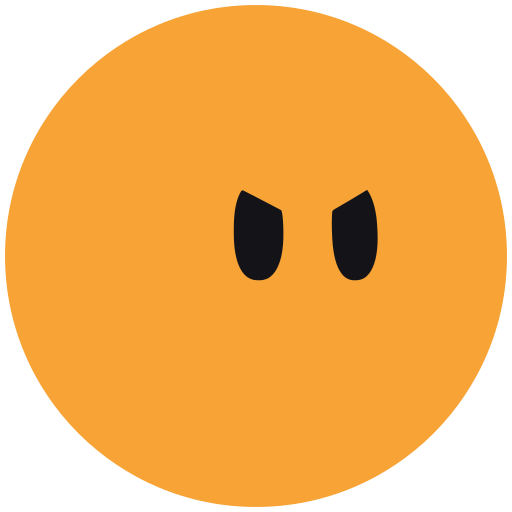
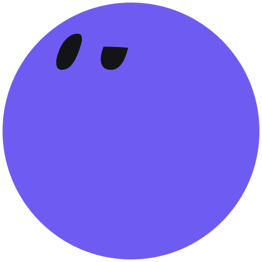
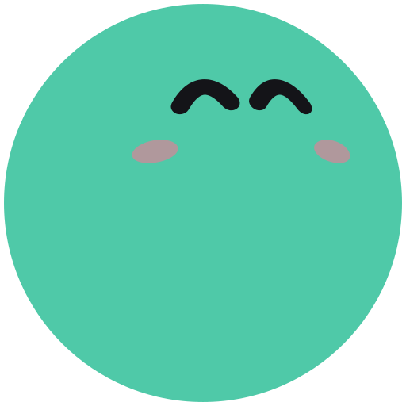
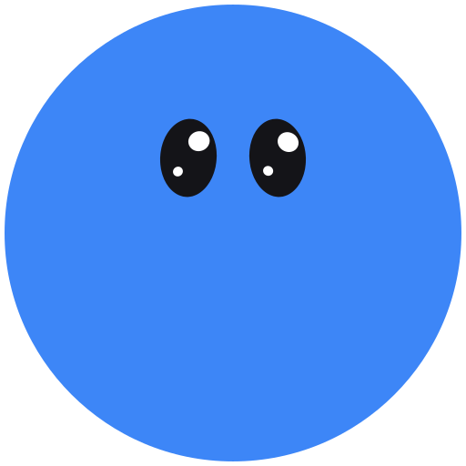

# orb

Chibi teammate avatars with faces painted onto a real sphere.

`<orb-avatar>` is a single, dependency-free Web Component. Each orb is a colored ball with a small face that turns in 3D, follows your cursor or glances around on its own, morphs smoothly between reactions, and reacts when you poke it. It works in plain HTML and in any framework.

**[Live demo and playground →](https://sundenlast.github.io/orb/)**

<p>
  
  
  
  
  
</p>

## Contents

- [Quick start](#quick-start)
- [Install](#install)
- [Reactions](#reactions)
- [Alive mode](#alive-mode)
- [Look modes](#look-modes)
- [Attributes](#attributes)
- [JavaScript API](#javascript-api)
- [Events](#events)
- [Styling and sizing](#styling-and-sizing)
- [Using it with frameworks](#using-it-with-frameworks)
- [Custom reactions](#custom-reactions)
- [Static SVG assets](#static-svg-assets)
- [Accessibility and performance](#accessibility-and-performance)
- [How it works](#how-it-works)
- [Browser support](#browser-support)
- [Project layout](#project-layout)
- [License](#license)

## Quick start

Paste this into any HTML page:

```html
<script src="https://cdn.jsdelivr.net/gh/sundenlast/orb@main/orb-avatar.min.js"></script>

<orb-avatar reaction="happy" color="#4fc9a8" mode="follow"></orb-avatar>
```

That's it. The orb is 64 px wide by default and looks at your cursor.

## Install

Pick one:

| Method | How |
|---|---|
| CDN | `<script src="https://cdn.jsdelivr.net/gh/sundenlast/orb@main/orb-avatar.min.js"></script>` (about 9.6 KB gzipped) |
| Pinned CDN (recommended for production) | Replace `@main` with a commit hash (such as `@2c50576`) or a release tag, so updates never change your page unexpectedly. |
| Copy the file | Download [`orb-avatar.min.js`](orb-avatar.min.js) (or the readable [`orb-avatar.js`](orb-avatar.js)) into your project and load it with a `<script>` tag. |
| npm, from GitHub | `npm install github:sundenlast/orb`, then `import 'orb-avatar';` once in your app's entry file. The import registers the element; the class is available as `window.OrbAvatar`, and types come from `orb-avatar.d.ts`. |

The script registers the `<orb-avatar>` element as soon as it loads. Load it once per page; loading it again is harmless.

## Reactions

Set the face with the `reaction` attribute. Switching reactions morphs the face over 0.42 seconds and gives the ball a brief jiggle.

| Reaction | Face | Movement |
|---|---|---|
| `idle` | Tall oval eyes that blink | None |
| `happy` | `^ ^` eyes with blush | Steady bounce |
| `thinking` | One lid half closed | Looks up and to the side, with a dot trail |
| `working` | Focused, narrowed lids | Scans left and right like it's reading |
| `done` | `^ ^` eyes with blush | Sparkles and a small hop |
| `needs` | Big shiny eyes | Faces you, hops, with a pulse ring ("needs you") |
| `sleeping` | Closed lids | Head down, slow bob, floating zzz |
| `error` | `> <` eyes | Quick shakes and a sweat drop |
| `love` | Heart eyes with blush | Sways, with a floating heart |
| `sad` | Droopy lids | Looks down, with a falling tear |
| `dizzy` | Spinning spiral eyes | Woozy sway, with stars circling overhead |
| `wink` | One open eye, one closed | Head tilted |

```html
<orb-avatar reaction="thinking"></orb-avatar>
```

```js
document.querySelector('orb-avatar').react('done');
```

### Pokes

Tapping or clicking an orb does nothing by default; call `poke()` to make it react. A poke jiggles the ball and plays a short reaction that escalates with rapid pokes: one poke surprises it, a second makes it giggle, and three or more in quick succession leave it `dizzy`, with spinning spiral eyes. Afterwards it returns to its current reaction. Pokes never change the `reaction` attribute.

```js
orb.addEventListener('click', () => orb.poke());
```

## Alive mode

Add `alive` and the orb lives a little life on its own. While its reaction is `idle` and nobody is interacting, it plays a random emote every so often. Ignored for long enough, it nods off and falls asleep. Moving the cursor near it, poking it, or giving it a new reaction wakes it up with a startle.

```html
<orb-avatar alive></orb-avatar>
<orb-avatar alive idle-time="4" sleep-after="120" emotes="yawn whistle cheeky"></orb-avatar>
```

Emotes never interrupt a reaction your app sets: an orb that is `working` or `needs` stays that way. `orb.emote(name)` plays one on demand in any reaction.

| Emote | What happens |
|---|---|
| `yawn` | Squeezes its eyes, tilts back with a big inhale, shivers, and tears up a little |
| `shifty` | Narrows its eyes and glances suspiciously left and right |
| `sneeze` | "Ah… ah…" wind-up, then ACHOO with a spray and a body jiggle |
| `hiccup` | Three hiccups, each a little jolt with wide eyes and a "hic!" |
| `whistle` | Content closed eyes, a lazy sway and floating music notes |
| `cheeky` | Alternating winks with head tilts and a blush |
| `vibe` | Bobs and sways to a beat with music notes |
| `peekaboo` | Turns its back on you, peeks around the edge, then spins back: boo! |
| `boop` | Leans in close to the screen and knocks on the glass twice |
| `derp` | One tiny eye, one huge eye, head tilted, then shakes it off |
| `idea` | Ponders, then a lightbulb pops on |
| `fly` | Tracks a buzzing fly with its eyes, goes cross-eyed when it lands on its head, then shakes it off |
| `bubble` | Blows a bubble-gum bubble, watching it cross-eyed until it pops and splats its face |
| `doze` | Head droops, jerks awake once, then falls asleep (not picked at random; used by `sleep-after` and `sleep()`) |
| `wake` | Startled awake with a "!" and a quick look around (played when a sleeping orb is woken) |

| Attribute | Default | Description |
|---|---|---|
| `alive` | off | Turns alive mode on. Boolean. |
| `idle-time` | `8` | Average seconds between emotes. The actual gap varies a little each time. |
| `sleep-after` | `60` | Seconds without interaction before it falls asleep. `0` never sleeps. |
| `emotes` | all | Space-separated list of emotes it may pick from, such as `"yawn whistle cheeky"`. |

Add your own with `OrbAvatar.defineEmote(name, { duration, weight, kicks, feats, motion, extra })`. It takes the same fields as a [custom reaction](#custom-reactions), plus `duration` in seconds, `weight` (how often it is picked relative to others, `0` for never) and `kicks`, a list of `[time, strength]` jiggles. `feats(t, e)` and `motion(t, e)` receive `e`, the seconds since the emote started.

## Look modes

The `mode` attribute controls where the face points.

| Mode | Behavior |
|---|---|
| `drift` (default) | Sways slowly around its home direction. |
| `follow` | Turns to look at the cursor anywhere on the page. When the cursor is idle for a few seconds it goes back to drifting. |
| `wander` | Glances at random spots on its own, holds each one for a moment, and sometimes darts. Ignores the cursor. |
| `fixed` | Holds still and looks exactly at `gaze`. Faces still morph and blink, and pokes still react, but reaction movements (hops, sways, shakes) are turned off. |

`gaze` sets the direction as `"yaw pitch"` in degrees. Positive yaw looks right, positive pitch looks up. The default is `"18 15"`, a slight up-and-right glance. `fixed` locks to it; `drift` and `wander` use it as home.

```html
<!-- Looks a little left and up, and never moves -->
<orb-avatar mode="fixed" gaze="-20 10"></orb-avatar>
```

Some reactions also steer the gaze (for example, `thinking` looks up and to the side and `sleeping` looks down). That blends with the mode, except in `fixed`.

## Attributes

| Attribute | Default | Description |
|---|---|---|
| `reaction` | `idle` | One of the [reactions](#reactions), or a name you registered. |
| `mode` | `drift` | `drift`, `follow`, `wander` or `fixed`. See [Look modes](#look-modes). |
| `gaze` | `18 15` | Home or fixed look direction, `"yaw pitch"` in degrees. |
| `color` | `#f1efe9` | Body color. Any CSS color, including `var(--your-token)`. |
| `eye-color` | `#141418` | Eyes and closed lids. |
| `size` | `64` | Ball diameter. A number means pixels; any CSS length works (`3rem`). |
| `jelly` | `0.6` | How much the ball jiggles on pokes and reaction changes, from `0` (none) to `1` (a lot). It is a perfect circle the rest of the time. |
| `face-scale` | `1.6` | Size of the face on the sphere. |
| `morph` | `0.42` | Seconds for one reaction to morph into the next. `0` switches instantly. |
| `shadow` | off | Draws a soft floor shadow that shrinks as the orb hops. Boolean. |
| `extras` | on | Floating sparkles, zzz, hearts, sweat drops and the pulse ring. Set `extras="off"` for dense lists. |
| `static` | off | Draws one frame and stops animating. Use for long lists, thumbnails and exports. Boolean. |
| `label` | reaction name | Accessible name announced by screen readers. |
| `alive`, `idle-time`, `sleep-after`, `emotes` | | See [Alive mode](#alive-mode). |
| `follow` | off | Older shortcut for `mode="follow"`. Still supported. |

Boolean attributes are on when present: `<orb-avatar shadow static>`. `shadow="false"` and `shadow="off"` also count as off.

Every attribute can be changed at any time, and the orb updates smoothly.

## JavaScript API

```js
const orb = document.querySelector('orb-avatar');

orb.react('thinking');           // same as setting the reaction attribute
orb.reaction;                    // 'thinking'
orb.mode = 'wander';             // same as setting the mode attribute

orb.poke();                      // jiggle + poke reaction
orb.poke(1.5);                   // stronger jiggle
orb.poke(1, { react: false });   // jiggle only, no face change
orb.spin();                      // full 360° turn
orb.blink();                     // blink now
orb.emote('sneeze');             // play an emote now
orb.sleep();                     // doze off and sleep until woken
orb.wakeUp();                    // wake a sleeping orb
orb.asleep;                      // true while sleeping

orb.lookAt(400, 300);            // look at a point, in viewport (client) pixels
orb.lookAt();                    // release; back to the current mode

const svg = orb.toSVG({ size: 256 });   // static SVG string of the current face
```

All methods return the element, so they can be chained: `orb.react('happy').spin()`.

Static members:

| Member | Description |
|---|---|
| `OrbAvatar.reactions` | Array of available reaction names. |
| `OrbAvatar.reactionLabel(name)` | Human-readable label, such as `"Needs you"`. |
| `OrbAvatar.defineReaction(name, def)` | Register a custom reaction. See [Custom reactions](#custom-reactions). |
| `OrbAvatar.shapes` | Shape helpers for building faces. |
| `OrbAvatar.emotes` | Array of emotes that alive orbs pick from. |
| `OrbAvatar.defineEmote(name, def)` | Register a custom emote. See [Alive mode](#alive-mode). |
| `OrbAvatar.quality` | `'auto'` (default) adapts detail to the device. Set `0` (full), `1` or `2` (lightest) to force a level. |
| `OrbAvatar.qualityLevel` | The level currently in use, `0` to `2`. |

`OrbAvatar` is also available as `window.OrbAvatar`.

## Events

| Event | `detail` | Fires when |
|---|---|---|
| `reactionchange` | `{ from, to }` | The `reaction` changes. |
| `emote` | `{ name }` | An emote starts, including `doze` and `wake`. |
| `poke` | `{ count, reaction }` | `poke()` plays a reaction. `count` is the number of pokes in the current streak; `reaction` is `surprised`, `giggle` or `dizzy`. |

All events bubble.

```js
orb.addEventListener('poke', e => {
  if (e.detail.count >= 3) console.log('Okay, okay, it is dizzy now.');
});
```

## Styling and sizing

- Size the orb with the `size` attribute or with CSS `width` (height follows; it's always square).
- The element box is the ball itself. Hops, shadows and extras draw outside that box without affecting layout, so leave a little room around orbs that bounce.
- Extras that are text-like (thinking dots and zzz) use the surrounding CSS `color`, so they match your theme. Set `color` on the element or a parent to change them.
- Orbs are drawn on a `<canvas>` exposed as `::part(canvas)`, if you need to add a filter or drop shadow:

```css
orb-avatar::part(canvas) { filter: drop-shadow(0 4px 10px rgb(0 0 0 / .25)); }
```

## Using it with frameworks

`<orb-avatar>` is a standard custom element, so it works anywhere HTML does.

### React

React 19 passes attributes to custom elements directly:

```jsx
import 'orb-avatar';

export function TeamMember({ status, color }) {
  const ref = useRef(null);
  return (
    <orb-avatar
      ref={ref}
      reaction={status}
      color={color}
      mode="wander"
      size="40"
      onClick={() => ref.current.poke()}
    />
  );
}
```

For TypeScript, add the element to JSX once:

```ts
// orb-avatar-jsx.d.ts
import type { OrbAvatar } from 'orb-avatar';
declare module 'react' {
  namespace JSX {
    interface IntrinsicElements {
      'orb-avatar': React.DetailedHTMLProps<React.HTMLAttributes<OrbAvatar>, OrbAvatar> & {
        reaction?: string; mode?: string; gaze?: string; color?: string; size?: string | number;
        jelly?: string | number; shadow?: boolean; static?: boolean; extras?: string;
      };
    }
  }
}
```

### Vue

Tell Vue that `orb-avatar` is a custom element (in `vite.config.js`):

```js
vue({ template: { compilerOptions: { isCustomElement: tag => tag === 'orb-avatar' } } })
```

```vue
<orb-avatar :reaction="status" color="#6e5cf2" mode="follow" @click="$event.target.poke()" />
```

### Svelte

```svelte
<script>
  import 'orb-avatar';
  let orb;
</script>

<orb-avatar bind:this={orb} reaction={status} mode="wander" on:click={() => orb.poke()} />
```

## Custom reactions

A reaction is a list of flat shapes ("features") in face space plus optional movement. Face space has `a` pointing right and `b` pointing up, measured in sphere radii, with the face centered at `0, 0`. The built-in eyes sit at `a = ±0.125`, `b = 0.15`.

Each feature has a slot `key`. Features in the same slot morph into each other when the reaction changes, so reuse the built-in slot names to get smooth transitions:

| Slot | Used for |
|---|---|
| `L`, `R` | Left and right eye |
| `hL`, `hR`, `h2L`, `h2R` | Eye highlights |
| `bL`, `bR` | Cheek blush |
| `tear` | Tear drop |

A feature that exists in only one of the two reactions pops in or shrinks away.

```js
const { capEye, arcEye, blush, F, ell } = OrbAvatar.shapes;

OrbAvatar.defineReaction('smug', {
  label: 'Smug',
  blink: false,
  feats: () => [arcEye(-1), capEye(1, .14), ...blush()],
  motion: t => ({ roll: .15, pitch: .2, w: .5 }),
  extra: 'sparkle',
});

OrbAvatar.defineReaction('shocked', {
  label: 'Shocked',
  feats: () => [
    F('L', ell(-.125, .15, .095, .095), [-.125, .15]),
    F('R', ell( .125, .15, .095, .095), [ .125, .15]),
  ],
  motion: (t, sincePoke) => ({ pitch: .1, w: .6, rollAdd: .04 * Math.sin(t * 30) }),
});

orb.react('smug');
```

Reaction definition:

| Field | Description |
|---|---|
| `label` | Display name. |
| `feats(t)` | Returns the features. Declare it with no parameter for a static face (it's cached); take `t` (seconds) for animated faces. |
| `motion(t, sincePoke)` | Optional. Returns `{ yaw, pitch, w, roll, rollAdd, yawAdd, dy, s }`. `yaw`/`pitch` (radians) are blended with the look mode by `w` (0 to 1). `dy` is vertical offset in ball radii (negative is up). `s` is uniform scale. |
| `blink` | Blink every few seconds. |
| `extra` | One of `dots`, `zzz`, `sparkle`, `heart`, `sweat`, `stars`, `ring`. |
| `hidden` | Leave it out of `OrbAvatar.reactions`. |

Shape helpers in `OrbAvatar.shapes`:

| Helper | Returns |
|---|---|
| `capEye(side, h?, w?, y?)` | Rounded tall eye. `side` is `-1` (left) or `1` (right). |
| `arcEye(side)` | Closed happy eye, `^`. |
| `lidEye(side, h, y, p, q)` | Eye with a lid cut along the line from `p` to `q`. |
| `blush()` | Two cheek blush ovals. |
| `F(key, points, center, fill?, opts?)` | A feature from any outline. `fill` is a palette name (`eye`, `hi`, `blush`, `tear`) or a CSS color. |
| `ell`, `superE`, `heart`, `drop` | Closed outlines. |
| `qb`, `polyline` | Open lines; pass them through `stroke(points, width)` to get a drawable outline. |
| `clipBelow(shape, p, q)` | Cut a shape along a line. |

Full types are in [`orb-avatar.d.ts`](orb-avatar.d.ts).

## Static SVG assets

Ready-to-use SVGs live in [`svg/`](svg). They're 512 × 512 with a transparent background and scale to any size.

| File | Reaction | Color |
|---|---|---|
| [`orb-idle-bone.svg`](svg/orb-idle-bone.svg) | Idle | Bone `#f1efe9` |
| [`orb-working-tangerine.svg`](svg/orb-working-tangerine.svg) | Working | Tangerine `#f7a335` |
| [`orb-thinking-iris.svg`](svg/orb-thinking-iris.svg) | Thinking | Iris `#6e5cf2` |
| [`orb-done-mint.svg`](svg/orb-done-mint.svg) | Done | Mint `#4fc9a8` |
| [`orb-needs-azure.svg`](svg/orb-needs-azure.svg) | Needs you | Azure `#3d86f7` |

To export any other combination, open the [playground](https://sundenlast.github.io/orb/), pick a reaction, color and angle, and press **Copy SVG**. In code, call `orb.toSVG({ size })`.

## Accessibility and performance

- Each orb is announced as an image. Its accessible name is the `label` attribute, or the reaction name if you don't set one.
- With the operating system's reduce-motion setting on, hops, sways and shakes inside reactions are turned off and morphs are shortened. Look modes, the poke jiggle and small face animations (spinning dizzy spirals, a falling tear) stay on because they are small and author-chosen. Use `static` or `mode="fixed"` to remove movement.

**Built to run on slow devices:**

- Orbs draw on `<canvas>`, so animating them never touches the page's DOM, styles or layout.
- An orb that isn't changing isn't redrawn. A still orb in `fixed` mode costs nothing between blinks.
- All orbs share one animation loop. Orbs scrolled off screen pause, and positions are read only after a scroll or resize, not every frame.
- A quality governor watches frame times. On a struggling device it lowers canvas resolution, then outline detail, then animates at half rate, and steps back up when there is headroom. Small orbs (under 48 px) always use lighter outlines.
- The math allocates no memory per point, so there are no garbage-collection pauses mid-animation.

Measured on the demo page with 19 orbs animating, in Chrome with the CPU slowed 6× to approximate a budget phone:

| Version | Normal CPU | CPU slowed 6× |
|---|---|---|
| 1.0 (SVG) | 60 fps, main thread 59% busy | 16 fps, 100% busy |
| 1.1 (canvas) | 60 fps, main thread 16% busy | 58 fps, 68% busy |

For long lists (dozens of orbs), use `static` and `extras="off"`, and animate only the ones that matter.

## How it works

**The face.** Every eye, highlight, blush and tear is a flat outline. Each frame, those points are wrapped onto a unit sphere at the direction the orb is facing, rotated by yaw, pitch and roll, and projected straight onto the screen. Points near the edge of the ball land close together, so the eyes squeeze into thin ovals as they turn away; past the edge they disappear.

```
facing  f = (sin yaw · cos pitch, −sin pitch, cos yaw · cos pitch)
point   d = f · cos ρ + (a·right + b·up) · sin ρ / ρ      where ρ = |(a, b)|
screen  (x, y) = center + radius · (d.x, d.y)           hidden when d.z < 0
```

**Morphing.** Every outline is resampled to the same 96 points with the same winding and starting point, so any eye can blend point by point into any other: an oval into a `^`, a heart or a `>`.

**The jiggle.** The body outline is `r(θ) = 1 + Σ aₖ cos kθ + bₖ sin kθ` for k = 2, 3, 4, with each term on a damped spring that rests at zero. Only pokes and reaction changes kick the springs, so the orb is a perfect circle the rest of the time. The face is warped by the same outline while it jiggles.

**Drawing.** Each orb owns a canvas slightly larger than its element box, so hops, shadows and extras can overflow without affecting layout. `toSVG()` builds SVG markup from the same geometry for exports.

**Looking.** Yaw, pitch and roll follow their targets through springs tuned for a slight overshoot, so turns feel alive rather than mechanical.

## Browser support

Any browser with Custom Elements, Shadow DOM and `ResizeObserver`: current Chrome, Edge, Firefox and Safari (including iOS). No polyfills, no dependencies.

## Project layout

```
orb-avatar.js     The component, readable source.
orb-avatar.min.js The same component, minified. This is the only file you need.
orb-avatar.d.ts   TypeScript types.
index.html        Demo and playground (served by GitHub Pages).
svg/              Ready-made SVG assets.
package.json      Lets you install from GitHub with npm.
LICENSE           MIT license.
```

To work on the component, edit `orb-avatar.js` and open `index.html` in a browser. Regenerate the minified file before committing:

```bash
npx terser orb-avatar.js -c passes=2 -m --comments '/^!/' -o orb-avatar.min.js
```

## License

[MIT](LICENSE) © 2026 Enzo Vasconcelos. Free to use, modify and distribute, including in commercial projects, as long as the copyright notice and license text stay with the code.
